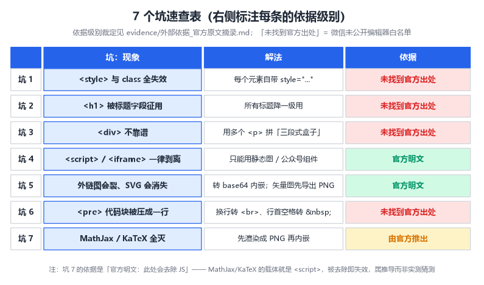
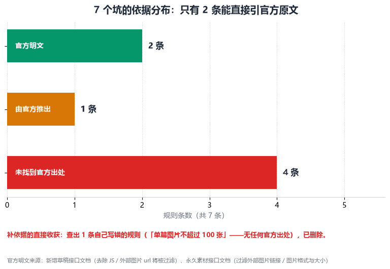
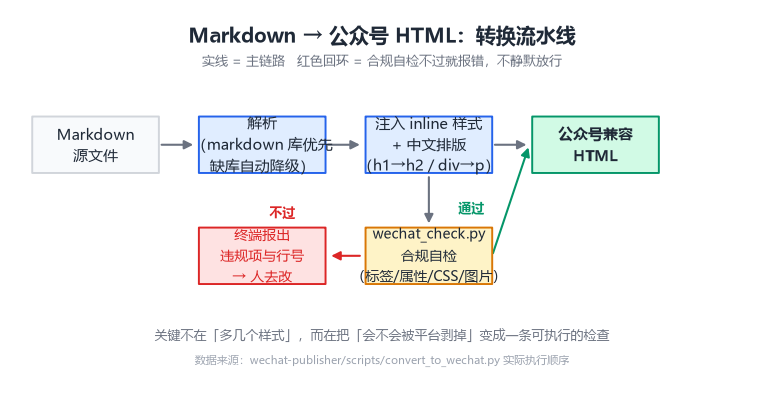

# 我把一篇 Markdown 粘进公众号，排版全没了

第一次把 Markdown 转成 HTML 粘进公众号编辑器时，我以为任务已经完成了。

浏览器里预览得好好的：标题有层级，代码有灰底，引用块有左边框。Ctrl+A、Ctrl+C、Ctrl+V——粘贴过去的一瞬间，样式像被抽走了一样，只剩一堆挤在一起的黑字。

那一刻我意识到一件被忽略的事：**公众号编辑器不是浏览器**。它只是一台非常挑剔的排版机器，只接受有限几种标签、只认 inline CSS、保存时还会悄悄丢东西。

后来我把这些限制一条条拆开，写进了一个转换器里。这篇文章记录那 7 个坑，以及它们背后的原因和解法。

> [!NOTE] 这篇文章的适用对象
> 用 Markdown / Word 写稿、需要发到公众号的人。如果你只发过纯文字，可能还没踩到这些坑；如果你发过带代码块或表格的技术文，下面至少有 3 条你会很熟悉。

先把 7 个坑铺在一张表里。注意右边那一列——**每条规则后面标着它的依据级别**：哪些能直接引官方原文，哪些查不到官方出处。这是这篇文章和网上大多数"踩坑总结"的差别：我把我查证过的边界也一并写清楚了，第四节会专门交代。



## 坑 1：`<style>` 标签和 class 全部失效

这是最致命的一个，也是掉样式最多的一个。

我们写网页时的常识是：样式写在 `<style>` 里，元素挂 `class`。但公众号编辑器会把 `<style>` 整块删掉，也会把所有 `class` 属性剥掉。结果就是——你精心写的 CSS 一行都没生效。

规则只有一条：**每个元素必须自带 `style="..."`**。

```html
<!-- ❌ 粘贴后样式全丢 -->
<style>.p { font-size: 16px; }</style>
<p class="p">正文</p>

<!-- ✅ 能活下来 -->
<p style="font-size: 16px; line-height: 1.75; color: #333;">正文</p>
```

麻烦的地方在于，这意味着 HTML 体积会膨胀好几倍——每个段落都要重复一遍同样的样式。但这是唯一能活下来的写法，没有捷径。

（依据说明：这条**查不到官方出处**——微信从没公开过编辑器的 HTML 白名单。它来自我的实测，且与所有同类转换工具的实现一致，见第四节。）

:::warning 别用布局类 CSS
`position`、`float`、`flex`、`grid`、`animation` 这些同样会被剥离。公众号只接受排版相关的属性：颜色、字号、行高、内外边距、边框、对齐。想做复杂排版（比如双栏、悬浮、动画），在公众号里基本无解。
:::

## 坑 2：`<h1>` 被系统征用了

公众号把 `<h1>` 留给文章标题字段，正文里的 `<h1>` 要么被丢掉，要么被降级，行为还不统一。

解法很简单：所有标题降一级用。

| Markdown | 转换后 |
|----------|--------|
| `# 标题` | 提到文章标题字段（不再出现在正文） |
| `## 章节` | `<h2>` |
| `### 小节` | `<h3>` |
| `#### 更小节` | `<h4>` |

顺带一个容易忽略的点：正文里也不能用 `id`，所以**做不了页内锚点**。自动生成的目录只能是纯文本编号列表，点了不会跳转。这不是 bug，是平台的限制。（依据：实测，未找到官方出处，见第四节。）

## 坑 3：`<div>` 不靠谱，盒子要用 `<p>` 拼

`<div>` 也在不受欢迎的名单里。这就带来一个现实问题：**高亮框（callout）怎么做？**

我们想要的那种"带背景色 + 左边框 + 标题"的知识卡片，本质是一个容器包住几段文字。没有 `<div>`，就得用几个 `<p>` 拼出来——关键是让相邻段落的边距归零，且只有首尾有圆角感的留白：

```html
<p style="background:#f0f7ff; border-left:4px solid #3b82f6; padding:14px 14px 6px 14px; margin:18px 0 0 0;">
  <span style="font-weight:bold; color:#3b82f6;">📘 知识点</span><br>这里是框里的第一段。
</p>
<p style="background:#f0f7ff; border-left:4px solid #3b82f6; padding:0 14px; margin:0;">第二段。</p>
<p style="background:#f0f7ff; border-left:4px solid #3b82f6; padding:0 14px 14px 14px; margin:0 0 18px 0;">最后一段。</p>
```

三个 `<p>` 拼起来，看起来就是一个完整的盒子。我给这套写法起了个名字叫"三段式盒子"，转换器里就是这么实现的。（依据：实测，未找到官方出处，见第四节。）

## 坑 4：所有交互性内容归零

`<script>` 和 `<iframe>` 一律被剥离。这背后的原因很好理解——公众号不可能允许第三方在它的文章里跑脚本或嵌入外部页面。

这条**不用靠猜，官方接口文档原文写着："此处会去除JS"**（出处见文末 ①）。这是 7 个坑里依据最硬的一条之一。

后果是：

- 交互式图表（ECharts、Plotly）**不能用**
- 嵌入的视频、音频、地图**不能用**
- 一切鼠标悬停、点击展开的效果**不能用**

能用的替代品只有静态图片，以及公众号自己的视频组件。

> [!NOTE] 这其实是个约束设计
> 看似是限制，但它逼着你想清楚：这篇文字的核心价值是什么？如果一个观点必须靠交互动画才能讲清，那大概更适合做成网页而不是公众号文章。

## 坑 5：图片——外链会裂，SVG 会消失

图片有两个独立的坑。

**第一个：外链图片不可靠。** 用 `https://` 引用的图片，粘贴时可能显示正常，也可能第二天裂开，取决于对方服务器和公众号的抓取策略。稳妥的做法是把图片转成 base64 内嵌：

```html

```

粘贴时公众号会自动把 base64 图片转存到自己的 CDN，之后就稳定了。

外链不可靠这条同样有官方明文，而且比"可能裂"严重——原文是："图文消息的具体内容中，**微信后台将过滤外部的图片链接**"（出处 ②）。不是"不稳定"，是"会被过滤"。

**第二个：SVG 会消失。** 如果你内嵌的是 `data:image/svg+xml;base64,...`，保存的那一刻它就消失了——公众号无法重新上传 SVG。官方的图片格式清单是 `bmp/png/jpeg/jpg/gif`（出处 ②），**里面根本没有 SVG 的位置**。矢量图必须先导出成 PNG。

:::warning 图片检查清单
- 格式：PNG / JPG / GIF（官方格式清单里没有 SVG 的位置）
- 单张大小：官方一处写 10M、另一处写 2MB，两处冲突——稳妥按 2MB 控制
- 外链：官方明文"外部图片url将被过滤"，能内嵌就内嵌
- 数量：未找到官方口径（我此前写的"单篇不超过 100 张"查无出处，已删除）
:::

## 坑 6：代码块会被压成一行

`<pre>` 标签在公众号里表现很不稳定，最常见的后果是缩进和换行一起消失，代码变成一坨。

解法是用 `<p>` 装代码，两件事必须做对：

1. 换行转成 `<br>`
2. **行首空格转成 `&nbsp;`**（普通空格在 HTML 里会被合并）

```html
<p style="background:#f6f8fa; font-size:14px; line-height:1.65; padding:14px 16px;">
  def hello():<br>&nbsp;&nbsp;&nbsp;&nbsp;print("缩进保住了")
</p>
```

（依据：实测。微信没有公开编辑器白名单文档，这条查不到官方出处，处理方式见第四节。）

## 坑 7：数学公式——MathJax 全灭，图片才活得下来

如果你写过带公式的文章（学习笔记、论文解读都算），这一坑最隐蔽。

Markdown 里写公式的主流方案是 MathJax 或 KaTeX：它们本质是一段 `<script>`，在浏览器里把 `$...$` 实时渲染成漂亮的数学符号。坑 4 说过，公众号会剥掉所有 `<script>`——于是公式在你自己的预览页面里渲染得好好的，粘进编辑器就退化成一行裸文本：

```
损失函数 L(θ) = (1/n)Σ(yi - f(xi))²  ← 粘贴后就是这个样子，符号全靠 Unicode 硬凑
```

如果渲染器走的是 SVG 输出，还会踩坑 5 的另一半：保存的那一刻直接消失。

**唯一活路：把公式先渲染成 PNG，再走图片内嵌**，和坑 5 的 base64 是同一条路。比如下面这个公式（你现在看到的是一张图，不是文字）：

$$S_{b64} \approx \frac{4}{3} S_{bin}$$

它的含义是坑 5 里提过的：base64 内嵌会把体积放大约三分之一。渲染时用 200 DPI 保证手机上不糊，代价是公式从此不可复制、不可搜索——所以正文里公式别滥用，能用文字说清的就别上公式。

（依据：这一条是**从坑 4 推出来的**——MathJax / KaTeX 的实现载体就是 `<script>`，而"此处会去除JS"是官方明文。被去除即失效，不需要另找依据，也做不了实测之外的许诺。）

顺带一个我自己踩的小坑：正文里的 `$` 符号会被公式解析器当成定界符，命令行的 `$PATH`、价格 "$5" 都可能被误伤。转换器必须**跳过代码区域**再做公式解析——这条我已经写进了检查逻辑，并且有专门的断言测试。

## 附赠两个：表格溢出与正文外链

**表格**没有横向滚动。列数一多，手机上就会被截断或撑破屏。宽表的处理办法是拆成两张，或者直接转成列表。

**正文里的外部超链接通常点不动**（白名单与公众号文章链接除外）。想给读者可点的链接，就放「阅读原文」；参考资料写在文末，用纯文本列出域名即可。

## 这些规则，哪些有官方依据？

写踩坑总结最容易犯的错，是把"我观察到的"说成"官方规定的"。所以这轮修改我给每条规则都做了查证，结果如下：



**能直接引官方原文的只有 2 条**（坑 4 和坑 5），逐字摘录是这样的：

- 「必须少于2万字符，小于1M，且**此处会去除JS**……**外部图片url将被过滤**」——新增草稿接口文档（出处 ①）
- 「图文消息的具体内容中，**微信后台将过滤外部的图片链接**」「图片（image）: 10M，支持bmp/png/jpeg/jpg/gif格式」——上传永久素材接口文档（出处 ②）

坑 7 是从坑 4 推导出来的，不算独立依据。**剩下 4 条（坑 1、2、3、6）我找不到官方出处**：微信从未公开过编辑器的 HTML 白名单，我翻遍了开发者文档也没有。这几条我只能如实说——是我的实测，且与同类转换工具的实现一致，但它们不是官方条文。

查证过程还有个意外收获：**我原来在图片清单里写了"单篇不超过 100 张"，为了写这一节去查出处，发现查不到任何官方来源**——官方社区置顶帖的说法反而是"没有图片数量限制"（该帖需要登录，我无法二次核验，所以不敢拿来当结论）。这条已经从文章里删掉了。补依据这件事，第一个受益的是我自己。

所有原文摘录、官方文档内部的口径冲突（字数上限两处不一样、图片大小 10M 与 2MB 打架、格式清单有无 bmp 不一致）都在随文的 `evidence/外部依据_官方原文摘录.md` 里，还配了一个能重新联网核验"这些原文是否还在页面上"的脚本。

## 我把这些规则写成了可执行检查

踩完这 7 个坑之后，我做了一件比"记住它们"更可靠的事：**把规则变成代码**。

我用 skill-creator 流程改造了一个 Markdown → 公众号 HTML 的转换器，整体流程是下面这样——注意中间那个红色回环，它是整个设计里最值钱的部分：



核心不是"多几个花哨样式"，而是三件事：

1. **转换后自动合规自检** —— 检查输出里有没有 `<div>`、`<h1>`、`class`、`position` 这类会被剥离的东西，发现问题直接报出来，而不是等你在手机上发现
2. **零依赖也能跑** —— 内置一个 Markdown 解析器，装不上第三方库时自动降级。两条解析路径对同一输入的产出是字节一致的（我为此写了断言测试）
3. **中文排版优化** —— 中英文之间自动补空格、中文后的半角标点转全角

| 能力 | 改造前 | 改造后 |
|------|--------|--------|
| 主题配色 | 无 | 4 套，可 JSON 自定义 |
| callout 框 | 无 | 5 种语义框 |
| 自动目录 | 无 | 支持 |
| 文章元数据 | 无 | 标题/作者/日期/摘要 |
| 页脚版权 | 无 | 自动生成 |
| 中文排版 | 无 | 间距与标点优化 |
| 图片处理 | 保留外链 | 本地图转 base64 |
| 数学公式 | 依赖 script，粘贴即裸奔 | mathtext 渲染成 PNG 内嵌（无渲染环境时降级并告警） |
| 输出校验 | 无 | 自动合规自检 |

> [!NOTE] 一个反直觉的收获
> 最值钱的不是"多了多少功能"，而是"能自动报错"。功能是我自己想得到的，错误是我自己想不到的——写检查器的人，是在替未来的自己省时间。

## 发布前的最后一道关

不管转换器多靠谱，有一件事不能省：**用手机预览**。

编辑器里的预览只反映排版，不反映真机的字体渲染、行距和图片缩放。我用"发送到手机预览"这一步抓出过好几次问题——某个表格在 iPhone 上溢出、某段代码的字号在小屏上偏小。

## 写在最后

这些坑的共同点是：它们**不会报错**。样式悄悄消失，图片隔天裂开，代码挤成一坨——没有一行提示告诉你哪里错了。

所以真正的解法不是"记住 7 条规则"，而是把规则固化到工具里，让机器替你检查。人记不住 7 条规则在第三篇文章的第七个段落里是否都遵守了，但脚本记得。

如果你也经常写 Markdown 然后发公众号，希望这份清单能让你少粘贴一次失败的排版。

## 参考资料

**官方文档（摘录时间 2026-10-07；正文外链点不动，域名请自行复制到浏览器）**

1. 新增草稿接口 · content 字段 —— 「必须少于2万字符，小于1M，且此处会去除JS」「外部图片url将被过滤」
   developers.weixin.qq.com/doc/service/api/draftbox/draftmanage/api_draft_add.html
2. 上传永久素材接口 —— 「微信后台将过滤外部的图片链接」「图片（image）: 10M，支持bmp/png/jpeg/jpg/gif格式」
   developers.weixin.qq.com/doc/service/api/material/permanent/api_addmaterial
3. 新增临时素材接口 —— 「图片（image）: 10M，支持PNG\JPEG\JPG\GIF格式」
   developers.weixin.qq.com/doc/service/api/material/temporary/api_uploadtempmedia

**随文开源的工具与证据**

- 转换器与合规自检：wechat-publisher 技能包（scripts/convert_to_wechat.py、scripts/wechat_check.py）
- 逐字摘录与冲突裁定：evidence/外部依据_官方原文摘录.md（附可复跑的核验脚本 evidence/外部依据_核验.py）
- 自检口径：满依赖环境 20/20、干净环境 18/20，两组对照的复现命令见 evidence/selftest_双环境口径.py

**边界说明**：坑 1、2、3、6 未找到官方出处（微信未公开编辑器 HTML 白名单），依据为实测与同类工具旁证；正文长度、图片大小等口径在官方文档内部存在不一致，逐条裁定见上面的摘录文档，本文一律按更严格的那个数值执行。
